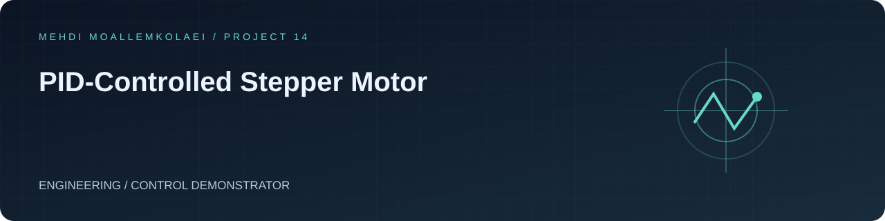
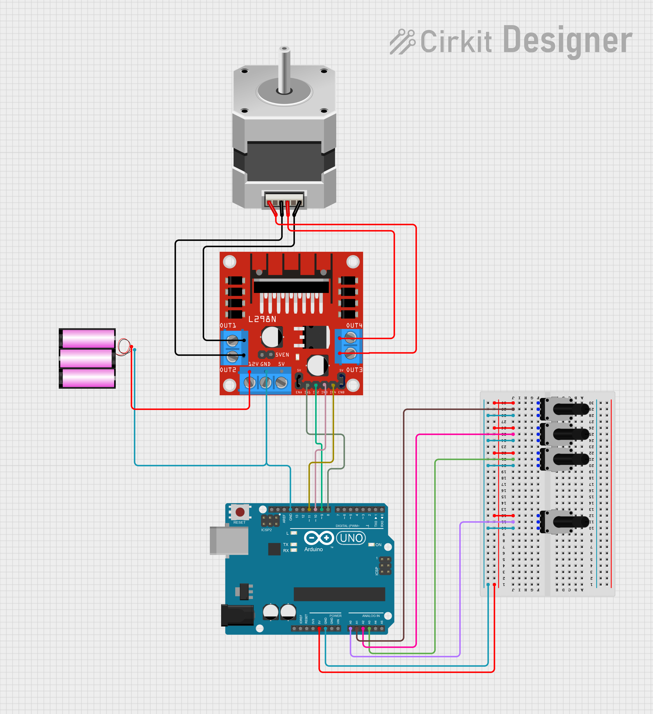

# PID-Controlled Stepper Motor

**Demonstrate PID calculations and live gain adjustment with an Arduino and stepper driver.**

Arduino Uno · L298N · PID · C++

[Project record](#bench-card) · [Design](portfolio/DESIGN.md) · [Setup](portfolio/SETUP.md) · [Validation](portfolio/VALIDATION.md) · [Evidence](portfolio/EVIDENCE.md)

<!-- project-navigation:start -->

  
  
  
  

<strong>Control demonstrator</strong> &nbsp; / &nbsp; Engineering &nbsp; / &nbsp; <a href="https://ace-alch.github.io/">Mehdi's portfolio</a>

<!-- project-navigation:end -->

## Bench card

| Item | Record |
| :-- | :-- |
| Project type | Control demonstrator |
| Field | Engineering |
| Material in this package | Existing repository inspected |
| Documentation review | 17 November 2026 |

## The build

Demonstrate PID calculations and live gain adjustment with an Arduino and stepper driver. The documentation separates the stated project scope, inspected artifacts and future work. A listed feature is not a new test result.

### Subsystems

- Target potentiometer
- Gain potentiometers
- PID calculation
- Step sequence
- Commanded step count

## Open the bench notes

1. Read the [design record](portfolio/DESIGN.md) for the system elements and boundaries.
2. Follow the [setup record](portfolio/SETUP.md) for available entry points.
3. Use the [validation plan](portfolio/VALIDATION.md) to record reproducible results.
4. Check the [evidence register](portfolio/EVIDENCE.md) before reusing claims.

## Technical limits

The source updates `currentPosition` when it commands a step. It does not read an encoder. The reported position is a commanded step count. It cannot detect missed steps or prove physical closed-loop position control. The integral has no anti-windup bound. The move loop can block input sampling.

## Project preview

This image is an existing repository artifact. It is not evidence of a new test.

<strong>Browse source files and project artifacts</strong>

| Path | Type |
| :-- | :-- |
| [LICENSE](https://github.com/Ace-Alch/PID_StepperMotor/blob/main/LICENSE) | file |
| [README.md](https://github.com/Ace-Alch/PID_StepperMotor/blob/main/README.md) | .md |
| [images/wiring.png](https://github.com/Ace-Alch/PID_StepperMotor/blob/main/images/wiring.png) | .png |
| [results/P.gif](https://github.com/Ace-Alch/PID_StepperMotor/blob/main/results/P.gif) | .gif |
| [results/PD.gif](https://github.com/Ace-Alch/PID_StepperMotor/blob/main/results/PD.gif) | .gif |
| [results/PID.gif](https://github.com/Ace-Alch/PID_StepperMotor/blob/main/results/PID.gif) | .gif |
| [results/PID_opt.gif](https://github.com/Ace-Alch/PID_StepperMotor/blob/main/results/PID_opt.gif) | .gif |
| [results/README.md](https://github.com/Ace-Alch/PID_StepperMotor/blob/main/results/README.md) | .md |
| [sketch_FinalPID/sketch_FinalPID.ino](https://github.com/Ace-Alch/PID_StepperMotor/blob/main/sketch_FinalPID/sketch_FinalPID.ino) | .ino |

See the [complete source inventory](portfolio/SOURCE-INVENTORY.md) for all inspected file paths.

## Verification backlog

- [ ] Independent shaft feedback
- [ ] Current and thermal checks
- [ ] Position limits
- [ ] Reproduced tuning measurements

## Credits and reuse

Project record: Mehdi Moallemkolaei. Specific third-party and course contributions must retain their original notices.

Existing license terms remain in effect. This package does not grant a new license over source code, course material, models or datasets. See [reuse and contribution notes](portfolio/CONTRIBUTIONS.md).

---

[Visual design notes](portfolio/VISUAL-DESIGN.md) · [Design tokens](portfolio/design-tokens.json)
