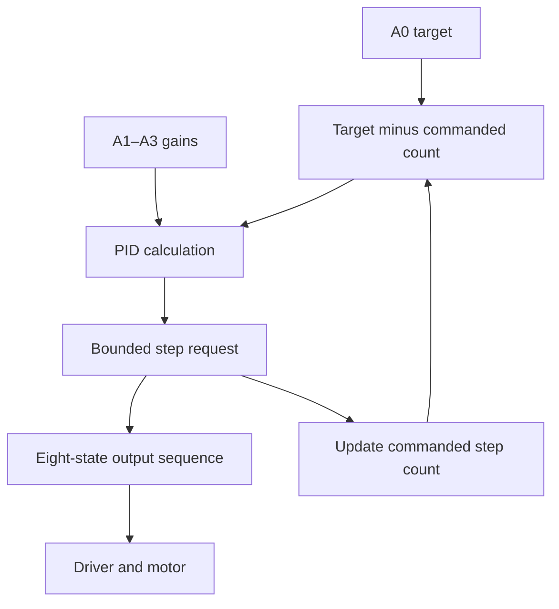

# PID-Controlled Stepper Motor: design record

## Purpose

Demonstrate PID calculations and live gain adjustment with an Arduino and stepper driver.

## Elements

| Element | Documentation boundary |
| :-- | :-- |
| Target potentiometer | Included in the stated project scope. Implementation details need the corresponding source or design file. |
| Gain potentiometers | Included in the stated project scope. Implementation details need the corresponding source or design file. |
| PID calculation | Included in the stated project scope. Implementation details need the corresponding source or design file. |
| Step sequence | Included in the stated project scope. Implementation details need the corresponding source or design file. |
| Commanded step count | Included in the stated project scope. Implementation details need the corresponding source or design file. |

## Technical stack

- Arduino Uno
- L298N
- PID
- C++

## Boundaries

The source updates `currentPosition` when it commands a step. It does not read an encoder. The reported position is a commanded step count. It cannot detect missed steps or prove physical closed-loop position control. The integral has no anti-windup bound. The move loop can block input sampling.

## Decisions to recover

Record each design decision with its problem, selected option, rejected options and supporting artifact. Keep the original model or source revision with the record.

## Inspected control implementation

| Input or setting | Source value |
| :-- | :-- |
| Target input | A0, mapped from 0–1023 to 0–400 steps |
| Proportional gain | A1 reading / 100 |
| Integral gain | A2 reading / 1000 |
| Derivative gain | A3 reading / 100 |
| Driver inputs | D8, D9, D10, D11 |
| Sequence | Eight output states |
| Move bound | PID output constrained to ±1000 commanded steps per move |
| Step delay | 2000 microseconds |
| Serial | 9600 baud |

The feedback path is internal software state. There is no measured motor position in this loop. Use independent shaft sensing to measure missed steps and tracking error. The output bound limits one move request; it does not prevent integral windup.

The current serial output includes a text label on each line. Treat it as diagnostic text until a stable numeric log format is defined.
